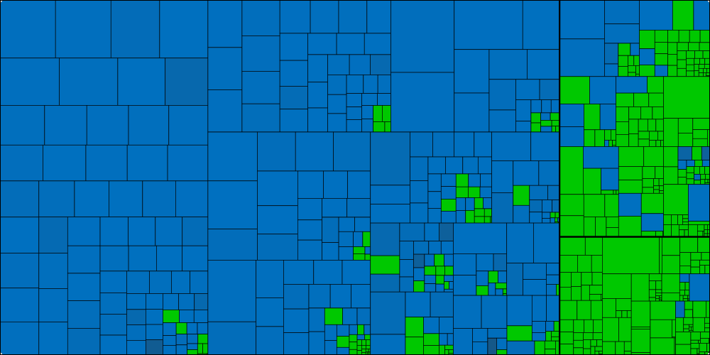
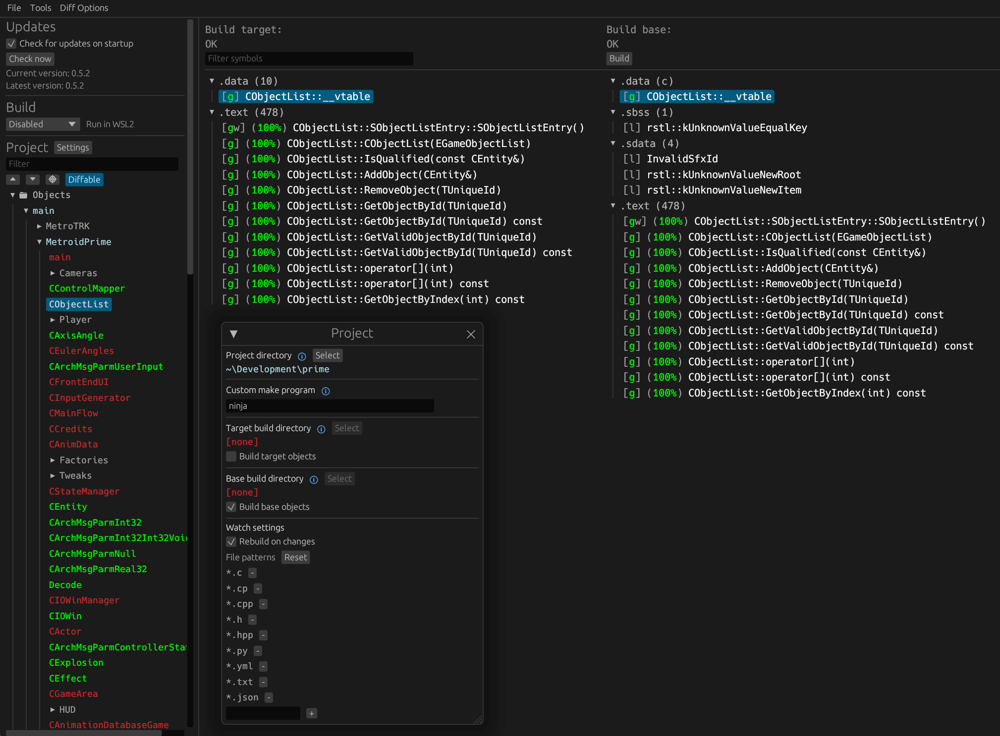

Super Mario Sunshine
=============

[](https://claude.ai/artifact/P341LnYJBNsiWYKJcdJKdV)

Each box is one source file, sized by its code.
Green: every function matches. Blue: partly matched (brighter is closer). Dark grey: not started.
Click the graph to open the [interactive map](https://claude.ai/artifact/P341LnYJBNsiWYKJcdJKdV), where each box opens that file's function list and source.
Regenerate it with `python3 tools/progress_treemap.py` after `ninja`.

<!-- progress:start -->
| | Code matched | Fuzzy | Functions matched | Units complete |
|---|---|---|---|---|
| **Total** | 51.19% | 98.86% | 10438 / 12881 | 407 / 736 |
| Game Code | 40.41% | 98.60% | 6503 / 8857 | 89 / 387 |
| JSystem Middleware | 87.29% | 99.74% | 2923 / 3009 | 172 / 200 |
| SDK Code | 98.88% | 99.97% | 1012 / 1015 | 146 / 149 |
<!-- progress:end -->

Upstream project: [doldecomp/sms](https://github.com/doldecomp/sms) ([upstream progress](https://decomp.dev/doldecomp/sms)).

A work-in-progress decompilation of Super Mario Sunshine.

This repository does **not** contain any game assets or assembly whatsoever. An existing copy of the game is required.

Supported versions:

- `GMSJ01`: Rev 0 (JPN)
- `GMSP01`: Rev 0 (PAL)
- `GMSE01`: Rev 0 (NTSC)
- `GMSJ01_01`: Rev 1 (JPN)
- `GMSP01_NX`: Rev 0 (Mario 3D All Stars (Switch))

Dependencies
============

Windows
--------

On Windows, it's **highly recommended** to use native tooling. WSL or msys2 are **not** required.  
When running under WSL, [objdiff](#diffing) is unable to get filesystem notifications for automatic rebuilds.

- Install [Python](https://www.python.org/downloads/) and add it to `%PATH%`.
  - Also available from the [Windows Store](https://apps.microsoft.com/store/detail/python-311/9NRWMJP3717K).
- Download [ninja](https://github.com/ninja-build/ninja/releases) and add it to `%PATH%`.
  - Quick install via pip: `pip install ninja`

macOS
------

- Install [ninja](https://github.com/ninja-build/ninja/wiki/Pre-built-Ninja-packages):

  ```sh
  brew install ninja
  ```

[wibo](https://github.com/decompals/wibo), a minimal 32-bit Windows binary wrapper, will be automatically downloaded and used.

Linux
------

- Install [ninja](https://github.com/ninja-build/ninja/wiki/Pre-built-Ninja-packages).

[wibo](https://github.com/decompals/wibo), a minimal 32-bit Windows binary wrapper, will be automatically downloaded and used.

Building
========

- Clone the repository:

  ```sh
  git clone https://github.com/doldecomp/sms.git
  ```

- Copy your game's disc image to `orig/GMSJ01`. (Or the appropriate version folder.)
  - Supported formats: ISO (GCM), RVZ, WIA, WBFS, CISO, NFS, GCZ, TGC
  - After the initial build, the disc image can be deleted to save space.

- Configure:

  ```sh
  python configure.py
  ```

  To use a version other than `GMSJ01` (JPN), specify it with `--version`.

- Build:

  ```sh
  ninja
  ```

Diffing
=======

Once the initial build succeeds, an `objdiff.json` should exist in the project root.

Download the latest release from [encounter/objdiff](https://github.com/encounter/objdiff). Under project settings, set `Project directory`. The configuration should be loaded automatically.

Select an object from the left sidebar to begin diffing. Changes to the project will rebuild automatically: changes to source files, headers, `configure.py`, `splits.txt` or `symbols.txt`.


